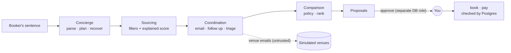

<h1 align="center">Thursday Dinner Concierge</h1>

<p align="center"><b>One sentence in. A booked, paid, on-policy dinner out.<br>Nothing happens until you approve.</b><br><sub>Built for the Ande AI Engineer role · independent project</sub></p>

<p align="center">
  <a href="https://akilalours.github.io/thursday-dinner-concierge/"><b>▶ Try it live</b></a> ·
  <a href="https://github.com/AKilalours/thursday-dinner-concierge/actions/workflows/ci.yml"></a>
  
  
</p>

<p align="center"><a href="https://akilalours.github.io/thursday-dinner-concierge/"></a><br><sub><a href="docs/img/demo.mp4">▶ 30-second video</a> · <a href="https://akilalours.github.io/thursday-dinner-concierge/">open the live app</a></sub></p>

<table align="center"><tr>
<td align="center"><h3>47/47</h3>eval scenarios</td>
<td align="center"><h3>0 / 2,013</h3>safety failures<br>in random worlds</td>
<td align="center"><h3>91</h3>tests, incl.<br>real Postgres</td>
<td align="center"><h3>9</h3>bugs caught →<br>permanent cases</td>
</tr></table>

```bash
npm install && npm run demo
```

**On the live site:** **Chat** (talk to the concierge, approve its proposal in the thread, then follow up: "make it 14", "move it to Friday", "2 are vegetarian", "cancel it"; every change is an approved proposal run through the typed tools) · Live desk · Book (slide to approve) · **Availability** (30 venues × 14 nights, priced under policy; click a cell to request, approve and book that exact table) · **Compare** (every offer the agent collected in one sortable table, side-by-side cards, propose any of them) · **Calendar** (drag a dinner to another night; the move is an approved amendment, refused by the database if the room is taken) · **Bookings** (receipt with tax, service, preferred rate and deposit; change headcount or night as an approved amendment, or cancel with the venue's refund window applied) · **Seating** (drag guests to seats, flag dietary needs, send the plan to the venue) · **Policy** (drag the caps and approval thresholds, see how many tables it unlocks, replay all 47 requests under the new policy before applying it) · **⌘K** to ask the concierge from any page · Inbox lab · **Fix lab** (replay a real failure with Claude's recorded 1/5 verdict, see the fix, prove it) · **Tools** (call the typed capabilities yourself) · **Judgments** (drag thresholds, force a timeout, watch the fallback) · Controls · Evals · Memory · Spend. Press **▶ Tour** for a hands-free one-minute walkthrough.

<details>
<summary><b>How it works</b></summary>



| | |
|---|---|
| **Agents** | Concierge + sourcing, comparison, venue-coordination subagents. Follow up on silence, widen the search, re-plan, fall through after a double booking. |
| **Changes after booking** | Amendments and cancellations are proposals too; an amendment swaps the booking atomically and rolls back if the new slot is taken. |
| **Spend control** | Policy as code: per-head caps, manager thresholds, notice; preferred corporate rates (12-15%) applied and reported. |
| **Typed tools** | zod in and out, run as the EA *for* the executive, idempotent, audited. `book`, `pay_deposit`, `amend_booking` and `cancel_booking` need an approved proposal. |
| **Evals** | 47 scenarios, invariant + expectation graders, LLM judge with calibration, recorded model calls replayed in CI, randomized fuzz. |
| **Memory** | Every venue reply leaves facts ("the Library really seats 10"). Sourcing uses them next time. Private memories protected by row-level security. |
| **Fast judgments** | Triage, SMS consent, urgency, injection. Threshold per label, timeout, safe fallback, `rules → shadow → live`. |
</details>

<details>
<summary><b>Safety, enforced by Postgres</b></summary>

| Rule | How |
|---|---|
| No booking or payment without every approval | `BEFORE INSERT` triggers |
| The agent can never approve | separate `ande_approver` role |
| Booking = exactly what was approved | trigger compares venue, room, party, time |
| Changes need approval, and never leave you with nothing | `amend_booking()` runs cancel + rebook in one transaction |
| No double booking | `EXCLUDE USING gist` |
| Pay only the payee on file, once | trigger + idempotency key |
| Private memories stay private | row-level security |
| History can't be rewritten | append-only audit log |
</details>

<details>
<summary><b>Bugs the evals caught</b></summary>

| | Bug |
|---|---|
| R1 | 7 pm dinner = midnight UTC → approver saw the wrong day |
| R2 | "the Library only seats 10" read as the offered room's capacity |
| R3 | Table for 4 priced as a private room → escalated as over budget |
| R4 | "Nov 18 at 7:30pm" parsed as a party of 18 |
| R5 | An offer carrying injected bank details was triaged as a payment request, losing the offer |
| R6 | **Found by the first live Claude run:** the extraction prompt didn't name the schema keys, so Claude returned its own field names and every offer silently fell back to rules |
| R7 | **Found by the LLM judge (1/5):** "japanese dinner" booked a Korean room; cuisine was a nudge, not a requirement. Now it books the cuisine or asks which constraint to relax |
| R8 | **Found by the LLM judge (4/5):** two vegetarians were sent to the venue but never confirmed to the booker |
| R9 | A model call that hit its timeout was retried, so a timeout cost twice the budget (an aborted fetch didn't say "timed out") |
</details>

<details>
<summary><b>Live model</b></summary>

- Claude (`claude-sonnet-4-5`) parses requests, extracts offers from venue email and judges proposal messages. Every output is recorded under `evals/recordings/` and replayed in CI and on the live site, so anyone sees exactly what Claude answered, with no key.
- First full live run: 45/45 scenarios, Claude decided 45/45 request parses and 117/117 offer extractions. The judge scored every proposal message 5/5 except two (4/5 and 1/5); both were real bugs (R7, R8), now fixed and graded deterministically.
- Put your key in `.env` once (`ANTHROPIC_API_KEY=...`); `npm run llm:check` verifies it, `npm run evals:live` re-measures and rebuilds the site.
- The LLM judge is calibrated with `node evals/calibrate.ts --export` plus human labels.
</details>

<details>
<summary><b>Commands</b></summary>

```bash
npm run demo -- --ask "private dinner for 20 with Globex on Nov 19"   # you approve
npm test                                       # unit + contract + end to end
ANDE_PSQL="-h localhost -U postgres" npm test  # also on real Postgres
npm run evals && npm run fuzz
npm run llm:check                              # one real model call: is the key working?
npm run build:web                              # rebuild the live playground in docs/
npm run site:check                             # real-browser check of every page at 3 screen sizes + main flows
```
</details>

The site deploys through `.github/workflows/pages.yml`: it is rebuilt from source and published only after typecheck, tests, evals and the browser check pass.

<sub>All venues, companies and people are fictional. Independent project.</sub>
