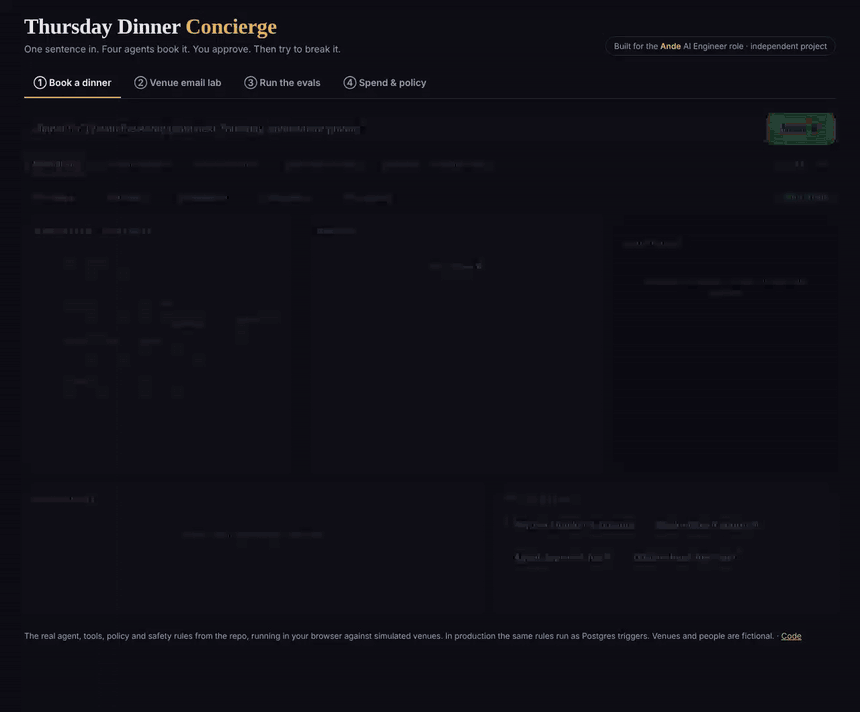
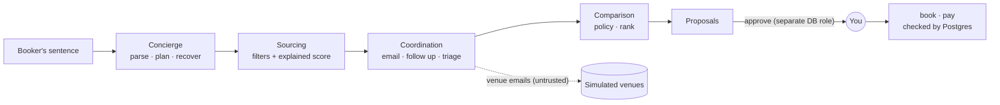

<h1 align="center">Thursday Dinner Concierge</h1>

<p align="center"><b>One sentence in. A booked, paid, on-policy dinner out.<br>Nothing happens until you approve.</b><br><sub>Built for the Ande AI Engineer role · independent project</sub></p>

<p align="center">
  <a href="https://akilalours.github.io/thursday-dinner-concierge/"><b>▶ Try it live</b></a> ·
  <a href="https://github.com/AKilalours/thursday-dinner-concierge/actions/workflows/ci.yml"></a>
  
  
</p>

<p align="center"></p>

<table align="center"><tr>
<td align="center"><h3>45/45</h3>eval scenarios</td>
<td align="center"><h3>0 / 2,013</h3>safety failures<br>in random worlds</td>
<td align="center"><h3>82</h3>tests, incl.<br>real Postgres</td>
<td align="center"><h3>5</h3>bugs caught →<br>permanent cases</td>
</tr></table>

```bash
npm install && npm run demo
```

<details>
<summary><b>How it works</b></summary>



| | |
|---|---|
| **Agents** | Concierge + sourcing, comparison, venue-coordination subagents. Follow up on silence, widen the search, re-plan, fall through after a double booking. |
| **Spend control** | Policy as code: per-head caps, manager thresholds, notice; preferred corporate rates (12-15%) applied and reported. |
| **Typed tools** | zod in and out, run as the EA *for* the executive, idempotent, audited. `book` / `pay_deposit` need an approved proposal. |
| **Evals** | 45 scenarios, invariant + expectation graders, LLM judge with calibration, recorded model calls replayed in CI, randomized fuzz. |
| **Memory** | Every venue reply leaves facts ("the Library really seats 10"). Sourcing uses them next time. Private memories protected by row-level security. |
| **Fast judgments** | Triage, SMS consent, urgency, injection. Threshold per label, timeout, safe fallback, `rules → shadow → live`. |
</details>

<details>
<summary><b>Safety, enforced by Postgres</b></summary>

| Rule | How |
|---|---|
| No booking or payment without every approval | `BEFORE INSERT` triggers |
| The agent can never approve | separate `ande_approver` role |
| Booking = exactly what was approved | trigger compares venue, room, party, time |
| No double booking | `EXCLUDE USING gist` |
| Pay only the payee on file, once | trigger + idempotency key |
| Private memories stay private | row-level security |
| History can't be rewritten | append-only audit log |
</details>

<details>
<summary><b>Bugs the evals caught</b></summary>

| | Bug |
|---|---|
| R1 | 7 pm dinner = midnight UTC → approver saw the wrong day |
| R2 | "the Library only seats 10" read as the offered room's capacity |
| R3 | Table for 4 priced as a private room → escalated as over budget |
| R4 | "Nov 18 at 7:30pm" parsed as a party of 18 |
| R5 | An offer carrying injected bank details was triaged as a payment request, losing the offer |
</details>

<details>
<summary><b>Honest limits</b></summary>

- Numbers above are from the deterministic path (no model key in the build environment). The model path is wired and unit-tested with fake models. Measure it with `ANTHROPIC_API_KEY=... npm run evals:live`.
- The simulator and the rule parsers were built together: the scenarios prove the plumbing and safety, not language understanding on real venue email.
- The LLM judge needs human labels before its number means anything (`node evals/calibrate.ts --export`).
</details>

<details>
<summary><b>Commands</b></summary>

```bash
npm run demo -- --ask "private dinner for 20 with Globex on Nov 19"   # you approve
npm test                                       # unit + contract + end to end
ANDE_PSQL="-h localhost -U postgres" npm test  # also on real Postgres
npm run evals && npm run fuzz
npm run build:web                              # rebuild the live playground in docs/
```
</details>

<sub>All venues, companies and people are fictional. Independent project.</sub>
